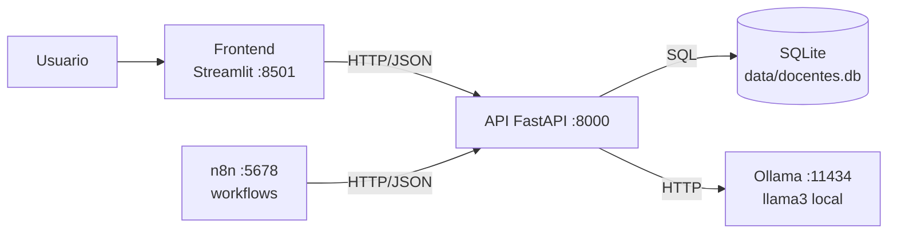

# Sistema Inteligente de Gestión de Planta Docente

Trabajo Práctico 2 — *Sistema integrado con Python, Low-Code e IA* (Proyecto B).

## Objetivo

Centralizar la información de la planta docente de una institución universitaria. El sistema permite:

- Registrar, consultar, modificar y dar de baja docentes, con búsqueda y filtros.
- Calcular indicadores de la planta: dedicaciones, horas, cobertura de materias y costo estimado.
- Detectar problemas automáticamente, como materias sin docentes o que dependen de un único docente.
- Analizar currículums con Inteligencia Artificial local (Ollama). La IA propone y una persona supervisa.
- Automatizar procesos con workflows de n8n.

## Componentes

| Componente | Tecnología | Ubicación |
|---|---|---|
| Frontend | Streamlit | `frontend/app.py` |
| Backend / API REST | FastAPI + Pydantic | `backend/` |
| Base de datos | SQLite | `backend/database.py` → `data/docentes.db` |
| Inteligencia Artificial | Ollama + modelo `llama3` (local, gratuito) | `backend/ia.py` |
| Automatización | n8n | `workflows/` |
| Contenedores | Docker / Docker Compose | `backend/Dockerfile`, `frontend/Dockerfile`, `docker/compose.yaml` |
| Pruebas | pytest | `tests/` |

## Arquitectura



### Estructura del backend

```
backend/
├── main.py
├── config.py
├── schemas.py
├── database.py
├── reglas.py
├── ia.py
├── errores.py
└── routers/
```

## Requisitos

- Python 3.12 o superior
- [Ollama](https://ollama.com) con el modelo `llama3`
- Docker Desktop
- Git

## Instalación

```bash
git clone https://github.com/NicoHat/TP2-Programacion-con-IA-y-LowCode.git
cd TP2-Programacion-con-IA-y-LowCode

python -m venv .venv
# Windows:
.venv\Scripts\activate
# Linux / macOS:
source .venv/bin/activate

pip install -r requirements.txt

ollama pull llama3
```

## Ejecución local

En terminales separadas:

```bash
uvicorn backend.main:app --reload
```

```bash
streamlit run frontend/app.py
```

| Servicio | URL |
|---|---|
| Frontend | http://localhost:8501 |
| API | http://localhost:8000 |
| Documentación interactiva de la API | http://localhost:8000/docs |

## Ejecución con Docker

```bash
cd docker

docker compose up -d --build
docker compose ps
docker compose logs -f api
docker compose restart frontend
docker compose stop
docker compose down
```

| Servicio | Puerto | Notas |
|---|---|---|
| Frontend | 8501 | Se conecta a la API por `API_URL` |
| API | 8000 | Volumen `../data` |
| n8n | 5678 | Volumen `n8n_storage` |
| Ollama | 11434 | Ejecutado en el host |

### Variables de entorno

| Variable | Valor por defecto | Uso |
|---|---|---|
| `OLLAMA_URL` | `http://localhost:11434` | Dirección de Ollama |
| `OLLAMA_MODEL` | `llama3` | Modelo de Ollama |
| `OLLAMA_TIMEOUT` | `120` | Tiempo máximo de espera (segundos) |

## Principales funcionalidades

### Interfaz (Streamlit)

| Sección | Funcionalidades |
|---|---|
| Planta Docente | Búsqueda y filtros por materia y dedicación, edición, baja con confirmación, evaluaciones de CV de cada docente |
| Registrar Docente | Alta con validación, selección de materia del catálogo o materia nueva, carga del CV desde archivo `.txt` / `.pdf` |
| Indicadores y Alertas | Métricas de la planta, distribución por dedicación y materia, cobertura de materias, alertas por severidad, informe ejecutivo con IA |
| Análisis de CV con IA | CV por texto o archivo, resultado de la IA y puntaje por reglas lado a lado, validación de la respuesta, revisión y aprobación antes de guardar, historial |

El estado de la API y de Ollama se muestra en la barra lateral.

### Gestión de docentes

| Método | Endpoint | Descripción |
|---|---|---|
| GET | `/docentes?materia=&dedicacion=&busqueda=` | Listar, buscar y filtrar |
| GET | `/docentes/{id}` | Consultar un docente |
| POST | `/docentes` | Registrar un docente |
| PUT / PATCH | `/docentes/{id}` | Modificar datos |
| DELETE | `/docentes/{id}` | Dar de baja |

### Indicadores y alertas

| Método | Endpoint | Descripción |
|---|---|---|
| GET | `/materias` | Materias con su cantidad de docentes y si están cubiertas |
| GET | `/indicadores` | Distribución por dedicación, horas, costo estimado, cobertura |
| GET | `/alertas` | Materias sin cobertura, un único docente, exceso de dedicación Simple, docentes sin CV |

### Inteligencia Artificial

| Método | Endpoint | Descripción |
|---|---|---|
| POST | `/ia/analizar-cv` | Análisis del CV con IA y puntaje de compatibilidad por reglas |
| POST | `/evaluaciones` | Registra una evaluación aprobada |
| GET / DELETE | `/evaluaciones` | Historial de evaluaciones |
| POST | `/procesar-cv-ia` | Analiza y registra el CV en un paso; sin Ollama devuelve solo el análisis por reglas |
| POST | `/ia/reporte` | Informe ejecutivo de la planta generado con IA |
| GET | `/health` | Estado de la base de datos y de Ollama |

### Errores

| Código | Significado |
|---|---|
| 201 / 204 | Creado / eliminado |
| 400 | Dato inválido |
| 404 | Recurso inexistente |
| 409 | Email duplicado |
| 422 | Error de validación |
| 502 / 503 / 504 | Error, indisponibilidad o tiempo de espera de la IA |

## Automatizaciones (n8n)

Workflows en `workflows/`, importables desde n8n con *Import from File*.

| Workflow | Disparador | Acción | Condición |
|---|---|---|---|
| Alta de docentes | Webhook `POST /webhook/alta-docente` / manual | `POST /docentes` | Respuesta 201: docente registrado; caso contrario: alta rechazada con el motivo |
| Análisis de CV con IA | Webhook `POST /webhook/analizar-cv` / manual | `POST /ia/analizar-cv`, `POST /evaluaciones` | Error de IA: se informa. Sin advertencias: se registra la evaluación. Con advertencias: queda pendiente de revisión |
| Control periódico de alertas | Lunes 8 h / manual | `GET /alertas`, `POST /ia/reporte` | Alertas altas: notificación con informe de IA. Sin alertas altas: planta en orden |

```bash
curl -X POST http://localhost:5678/webhook/alta-docente -H "Content-Type: application/json" \
  -d '{"nombre":"Lic. Ana Gómez","email":"agomez@uni.edu.ar","materia":"Bases de Datos Relacionales","dedicacion":"Simple"}'
```

## Pruebas

```bash
python -m pytest -v
```

Las pruebas usan una base de datos temporal y una respuesta simulada de Ollama.

## Integrantes y responsabilidades

| Integrante | Responsabilidad |

Nicolas Daniel Rotiroti: Backend, automatización e IA (API FastAPI, reglas de negocio, integración con Ollama, workflows n8n, Docker y pruebas)
Tomas Gonzalez: Base de datos (modelo SQLite, validaciones y datos de ejemplo)
Daniel Perez Albiero: Frontend (interfaz en Streamlit e integración con la API)


## Bitácora de uso de IA

Ver [`docs/bitacora_ia.md`](docs/bitacora_ia.md).
